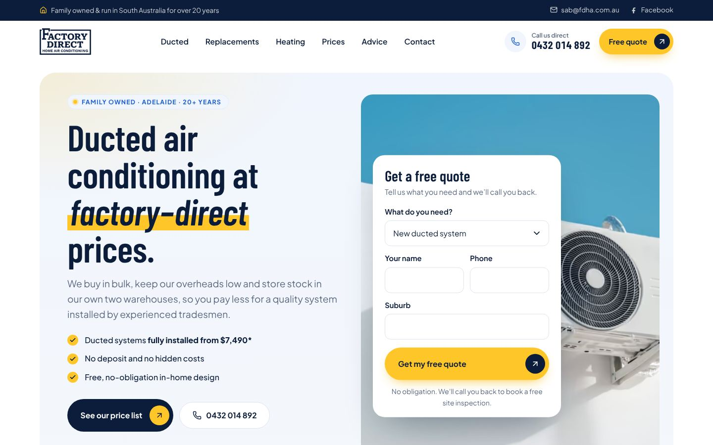
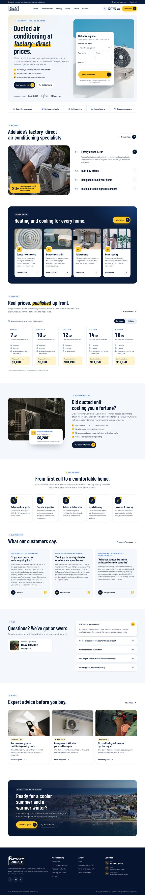

# Factory Direct Home Air Conditioning: website

A new website for [Factory Direct Home Air Conditioning](https://www.factorydirecthomeair.com.au/), a family-owned
reverse cycle air conditioning company in Adelaide. It replaces the current Squarespace site and keeps all of its URLs,
content, prices and reviews.



| Desktop | Mobile |
| --- | --- |
|  |  |

More screenshots: [ducted page](docs/screenshots/ducted-desktop.jpg) · [price list](docs/screenshots/price-list-desktop.jpg)

## What's in it

- **13 pages**, all on the same URLs as the current site, so Google rankings carry over.
- **Lead capture everywhere:** a quote form in the home page hero, a full form on `/contact`, a phone number in the
  header and a sticky *Call / Free quote* bar on mobile.
- **Published prices** pulled from one data file: ducted packages with a Samsung / Fujitsu switch, the full price table
  and the replacement-unit options.
- **Interactive explainers:**
  - a cutaway of a ducted system with a cooling/heating switch and zones you can turn on and off, which updates the
    heat load
  - a thermostat slider on the running-costs guide
  - a horsepower vs kW comparison
  - an outdoor-unit clearance diagram
- **SEO:**
  - a unique title and description on every page (the current site has none)
  - `HVACBusiness`, `BreadcrumbList`, `FAQPage`, `Article` and `OfferCatalog` structured data
  - sitemap, robots.txt, share images, and 301 redirects for old URLs
- **Accessibility:** 0 axe violations (WCAG 2.1 AA + best practice) on every page at desktop and mobile widths. Keyboard
  accessible, visible focus, reduced-motion support.
- **Fast:** static HTML, self-hosted fonts, responsive AVIF/WebP images and very little JavaScript. The home page's
  initial load is about 350 KB before gzip.

## Pages

| URL | Page |
| --- | --- |
| `/` | Home |
| `/home-air-conditioning-adelaide` | All services (includes split systems) |
| `/ducted-reverse-cycle-air-conditioners` | Ducted reverse cycle |
| `/air-conditioning-adelaide/ducted-air-conditioning-replacement-units` | Replacement units |
| `/heating-your-home` | Home heating |
| `/price-list` | Price list |
| `/faqs` | Advice & FAQs |
| `/how-to-reduce-air-conditioning-running-costs` | Guide: running costs |
| `/what-is-horsepower` | Guide: horsepower vs kW |
| `/air-conditioning-maintenance-tips` | Guide: maintenance |
| `/contact` | Contact / quote form |
| `/thank-you`, `/404` | Form confirmation and not-found pages (not indexed) |

## Running it

Requires Node 22.22 or newer.

```bash
npm install
npm run dev       # local dev server at http://localhost:4321
npm run build     # production build into dist/
npm run preview   # serve the production build
npm run check     # type-check the project
```

## Editing content

Almost everything lives in `src/data/`. Change it there and every page updates.

| File | What's in it |
| --- | --- |
| `site.ts` | Business name, phone, email, Facebook, nav menus, quote-form settings. **ABN, ARCtick number, address and hours** are empty and hidden; fill them in and they appear in the footer and the structured data. |
| `prices.ts` | Ducted packages (Samsung & Fujitsu) and replacement-unit prices. |
| `reviews.ts` | Customer reviews, word for word. |
| `faqs.ts` | FAQ questions and answers (also used for Google's FAQ data). |
| `photos.ts` | Every photo with its alt text and source. |
| `articles.ts` | The advice-guide cards. |

The guides themselves are in `src/pages/*.astro` as plain HTML.

## Quote form

Set `quoteForm` in `src/data/site.ts`:

- **`mailto`** (default): works anywhere with no setup. Submitting opens the visitor's email app with the request
  filled in and addressed to `sab@fdha.com.au`.
- **`endpoint`**: sends the request straight to your inbox through a form service. No email app is needed on the
  visitor's side.
  - [Formspree](https://formspree.io): create a form and set `endpoint` to its URL.
  - [Web3Forms](https://web3forms.com): set `endpoint: 'https://api.web3forms.com/submit'` and
    `hiddenFields: { access_key: 'your-key' }`.

I'd recommend switching to `endpoint` before launch so you get every enquiry, even when a visitor has no email app set
up.

## Deploying (Vercel)

The site is static and deploys to Vercel with no adapter. `vercel.json` handles:

- **Clean URLs:** `/price-list` is served from `price-list.html`, and `/price-list.html` and `/price-list/` redirect to
  `/price-list`.
- **301 redirects** from older URLs (for example `/general-information/maintenance-tips`) to the new pages.
- **Long-lived caching** for the fingerprinted files in `/_astro/`, plus basic security headers.
- **`noindex` on `*.vercel.app` addresses**, so the staging copy stays out of Google. The real domain isn't affected.

**Vercel project:** `fdhac`, live at https://fdhac.vercel.app.

**Auto-deploys:** connect this repo under Vercel → `fdhac` → Settings → Git → *Connect Git Repository* (GitHub →
`13V/FDHAC`). After that, pushes to the production branch go live and other branches get preview URLs. The
production branch defaults to the repo's default branch, currently `claude/ecstatic-wright-8v5jzu`. If you create a
`main` branch, switch it there. Until the repo is connected, deploy from the command line:

```bash
npx vercel deploy --prod
```

To go live on the real domain:

1. In Vercel → Project → Settings → Domains, add `www.factorydirecthomeair.com.au` and `factorydirecthomeair.com.au`.
   Set the bare domain to redirect to `www`.
2. At the domain's DNS provider (currently Squarespace), add the records Vercel shows. Change only those A/CNAME
   records, not the nameservers, so any other records on the domain stay untouched.

Vercel builds with its default Node.js 24, which satisfies the project's `>=22.22.0` requirement.

## Photos

The photos are **free-licence stock placeholders** from Pexels and Unsplash. Both licences allow commercial use without
attribution. The site will feel much more trustworthy with real photos of the team, vans and finished installs. To swap
one, add the file to `src/assets/photos/` and point the entry in `src/data/photos.ts` at it.

None of the images from the current site are reused. Several were stock images of unclear licence, and one is
literally named `ducted-air-conditioning-installation-northern-beaches-nsw.jpg`.

Brand logos (Samsung, Fujitsu, Hisense) are their trademarks, shown as an installer of those brands, as on the current
site. Fonts: Barlow Condensed and Plus Jakarta Sans (SIL Open Font License). Icons: Lucide (ISC).

## Things to confirm with the client

The current site contradicts itself in a few places. The new site uses the most conservative reading; please confirm:

1. **Phone number.** `0432 014 892` is used everywhere. `0493 400 767` also appears on the old heating, maintenance and
   price-list pages.
2. **Years in business.** The home page says "over 20 years" and the heating page says "more than 30 years". The new
   site says "over 20 years".
3. **Warranty.** The old replacement page says "a 5 year warranty: installation guaranteed for 5 years and components
   guaranteed for 20 years". Only the 5-year warranty is used until the 20-year claim is confirmed.
4. **Payment terms.** The old site says both "full payment within 7 days" and "full payment on completion". The new site
   says "no deposit, invoice emailed or posted after the job".
5. **No deposit.** This is stated on the replacement page. The new site presents it as applying to all jobs.
6. **Replacement prices.** The 12, 14 and 15.5 kW options didn't say "from" on the old site. They now say "from" like
   the others, since all prices are subject to site inspection.
7. **Filter cleaning.** The old maintenance page says both "gently vacuum the filters" and "never use a vacuum cleaner".
   The new copy says to follow the owner's manual.
8. **Instagram.** The old site links to Squarespace's placeholder Instagram, so it has been removed. Add the real
   account to `site.ts` if there is one.
9. **Missing trust details.** Add the ABN, ARCtick authorisation number, business address or service area, and opening
   hours to `site.ts`.
10. **Reviews.** No star ratings or review counts are shown because we don't have verified numbers. If they have Google
    reviews, the real rating can be added.

## Project structure

```
src/
  assets/       photos and brand logos (optimised at build time)
  components/   Header, Footer, QuoteForm, HouseDiagram, PackageExplorer, ...
  data/         all editable content (see above)
  layouts/      Base (head, SEO, header/footer) and Article (advice guides)
  pages/        one file per page, same URLs as the current site
  styles/       global.css: design tokens and shared styles
public/         favicon, share image, robots.txt
docs/           screenshots
vercel.json     clean URLs, redirects and headers for Vercel
```
